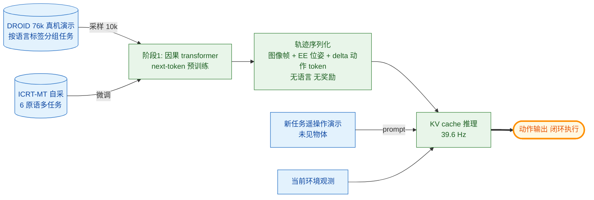

# ICRT: In-Context Imitation Learning via Next-Token Prediction（机器人 ICL 落地）

- arXiv: https://arxiv.org/abs/2408.15980
- Source: https://arxiv.org/abs/2408.15980
- Project: https://icrt.dev
- 本地 PDF：`papers/architecture/ICRT_2408.15980.pdf`
- Year: 2024 (ICRA 2025)
- Category: rl
- Priority: high

## 一句话总结

UC Berkeley AUTOLAB（Letian Fu、Huang Huang 等，Ken Goldberg 组）+ Autodesk 把 LLM 的 ICL 直接搬上真机器人：**ICRT 用因果 transformer 在感觉运动轨迹（图像+本体状态+动作 token）上做纯 next-token 预训练，不用语言、不用奖励、不用复杂损失**；测试时给一段遥操作演示轨迹作 prompt（新任务=未见物体+已训原语组合），模型在新环境配置下直接闭环执行——39.6 Hz 实时控制（KV cache 把每步推理从全序列二次降为线性）。真机 Franka 上 12 个未见任务 ×5 难度档，ICRT 平均 79.2%（pick 65.0 / poke 93.3），碾压 goal-conditioned 的 Octo（20.0%）与语言条件的 OpenVLA（单演示下频繁抓错/做错任务）。三个反直觉消融：**Llama2-7B 初始化更差**（训练损失更低但真机 58.3 < 79.2，语言先验与感觉运动序列不匹配）；**只用 DROID 不微调得 0 分**（域差距硬边界）；**对演示前缀也算损失会崩到 22.5**——上下文只该条件化、不该被预测。库内 ICL 线的机器人锚点：AD 蒸馏 RL 算法、ICRT 直接模仿，两端夹出"经验即上下文"的可行域。

## 九问速览

1. **Problem**：机器人基础模型（RT-X/Octo/OpenVLA 类）学新任务仍要微调或语言指令；理想状态是 LLM 式的——给几条演示，当场就会，零参数更新。
2. **Bottleneck**：现有多任务策略的条件化通道（语言/goal 图像）分辨率不够——"抓萝卜放灰碗"这种组合任务语言描述有歧义、goal 图像在 poke 类任务里与初始状态几乎同貌；few-shot 模仿学习又依赖对比学习式任务编码器等复杂机械。
3. **Insight**：演示轨迹本身（图像-状态-动作三元组序列）已隐式编码任务原语与目标物体——把它整个当 prompt 塞给 next-token 模型，ICL 自然发生，不需要任何任务识别辅助结构。
4. **Method**：D=轨迹集合按任务分组（DROID 的语言标签免费提供分组）；causal transformer 自回归预测动作 token；两阶段（DROID 10k 预训练 → ICRT-MT 自采 6 原语多任务微调）；测试时 prompt=新任务遥操作演示+当前观测。
5. **Evidence**：12 未见任务（pick-and-place/poke × 域内域外物体）×5 干扰物难度档：ICRT 79.2% 平均；Octo（goal+语言）20.0%；OpenVLA（语言）在单演示下频繁识别错任务。
6. **Ablation**：Llama2 初始化 58.3（更低 loss 更差真机）；DROID-only 0.0；MT-only 73.3；+Prompt Loss 22.5——四个消融把"简单方法为什么必须这样简单"论证得很干净。
7. **Assumption**：新任务=已训原语×未见物体的组合（组合泛化假设）；演示与执行同本体同视角（Franka+固定侧视+腕视）；任务分组标签可得。
8. **Failure**：同色异形干扰物时选错物体（视觉编码器不够强，作者归因与 OpenVLA 结论一致）；抓取精度类失败；跨本体/跨域（DROID-only 0 分）不通。
9. **Opportunity**：与语言条件融合（歧义时用演示消歧）；上下文长度扩展到多演示/多任务；VLA 底座上复现此 recipe（π0 系换条件化通道）。

| 维度 | 论文答案 |
|---|---|
| Perception | 演示轨迹（RGB×2+EE 位姿+动作）+ 当前观测；无语言通道 |
| Closed-loop | 39.6 Hz 闭环：每步新观测进上下文，KV cache 增量推理 |
| Correction | 25 秒/375 步内重试；上下文含失败历史（隐式） |
| Deployment | 零微调部署；换任务=换 prompt 演示；代码/检查点/数据全开（icrt.dev） |

## 核心技术

*架构速览：感觉运动轨迹的纯 next-token 预训练（DROID→自采两阶段）；测试时演示轨迹即 prompt，KV cache 增量推理实现 39.6Hz 真机闭环 ICL*

1. **数据配方**：DROID（76k 真机演示，语言指令标签天然提供任务分组）采 10k（滤掉 <30 步与 >450 步）预训练 + ICRT-MT（自己平台上 6 个运动原语×多物体）微调——通用数据学"轨迹语法"，域内数据学"本体对齐"。
2. **序列化**：轨迹 T=(i,s,a) 序列；状态=绝对 EE 位姿，动作=delta 平移+delta 旋转+连续夹爪，全部离散 token 化（FAST 式思路）；**无语言模态**——任务信息全部由演示携带。
3. **训练目标极简**：标准因果 LM 损失只在动作 token 上（对演示前缀算损失反而崩——见消融）；无辅助损失、无对比任务编码、无关键帧选择——与 few-shot IL 的繁复机械形成鲜明对照。
4. **推理工程**：KV cache 存已见序列，每步只算新 token 的注意力——复杂度从 O(L²) 摊到 O(L)，39.6 Hz 支撑闭环；这是"上下文范式"能上真机的工程前提。
5. **评测设计**：任务=原语×物体解耦（训练 6 原语、测 pick&place/poke 两原语的未见物体组合）；5 个难度档（0-4 个干扰物/干扰放置位）；25 秒重试制；pick 计 0.5/1 两级分。

## 底层原理与数学推导

**ICL 视角下的条件化**。策略 π(a | prompt τ_demo, 当前历史 h_t) 由 next-token 模型实现：演示占据上下文前缀，模型在当前观测位置的输出分布即动作分布。与语言条件的 OpenVLA 相比，演示条件的信息量：语言"把萝卜放进灰碗"在多物体场景里有指称歧义，演示轨迹逐帧展示"抓哪个、放哪"；与 goal 条件的 Octo 相比，poke 任务的终态与初态几乎同貌（目标=动作方式而非结果状态）——**演示是分辨率最高的任务说明符**。

**+Prompt Loss 为什么有害**。若对演示 token 也算 LM 损失，梯度把容量用于"预测演示的观测与动作"（建模环境动力学+演示者行为），与"条件于演示输出当前动作"的目标竞争。这与 AD 的对照（ED 失败）镜像：AD 证明数据要含学习进程，ICRT 证明上下文要免预测负担——**条件化与生成分离**是 ICL 范式的训练侧公理（也呼应 many-shot 的 NTP 损失与 ICL 性能脱钩）。

**Llama2 初始化为什么不灵**。语言预训练的注意力模式（词法/句法归纳偏置）与感觉运动 token 流的统计（空间-时间平滑性、控制闭环相关性）错位；7B 的更低训练损失说明它更强地拟合了轨迹分布，但拟合的是错误的东西（更依赖上下文记忆而非任务推断）——**ICL 需要的是推断结构，预训练先验错了方向不如白纸**。

## 物理直觉解释

带新徒弟的两种方式：给他一本说明书（语言条件）或描述目标照片（goal 条件），都不如**当面演示一遍**——他看着你的手怎么走、抓了哪个东西，转场到隔壁工位照样比划。ICRT 的关键是徒弟平时看过大量老师傅干活（DROID+MT 预训练），"看演示→照着做"这个映射本身已经练熟，新任务只是换个输入。39.6 Hz 的意义：徒弟不是看完回想再动，而是边看边跟着你的节奏走——闭环实时性就是模仿的保真度。

## 工程细节与实操指南

- 复现包完整：代码/检查点/ICRT-MT 数据全开（icrt.dev，github.com/Max-Fu/icrt）；基座为中等规模因果 transformer（论文最优配置非 Llama2-7B）。
- 动作表示：delta-EE + 连续夹爪离散 token；本体=绝对 EE 位姿——与 pi0 的设计对照，EE 空间序列化对 ICL 友好（平滑、低维、跨任务同构）。
- 部署要点：KV cache 常驻 + 每步追加 (o,a)；演示 prompt 一次前向填满 cache；25 秒任务窗内不重建。
- 想在自己平台复刻的最小路径：采 6-10 个原语×N 物体的多任务数据（几百条轨迹量级）微调 DROID 预训练检查点，测试留未见物体组合。
- 失败模式清单：同色异形干扰物选错（视觉编码需增强）；长程任务上下文管理未做（单演示短任务为主）。

## 实验协议清单

- 平台：Franka Emika + 固定侧视相机 + 腕相机；6 训练原语；评测原语 pick-and-place 与 poke。
- 任务：每原语 6 个未见任务（3 域内物体泛化 + 3 全新物体：萝卜/海绵/狗玩偶），×5 难度档（0-4 干扰物/干扰位）；每档一次，报任务均分±标准误。
- 基线：Octo（goal 图+语言，20.0% 平均）、OpenVLA（语言+微调范式单演示）、goal-conditioned 变体。
- 消融四件套：Llama2-7B 初始化（58.3）、DROID-only（0.0）、MT-only（73.3）、+Prompt Loss（22.5）vs 完整版 79.2。
- 实时性：39.6 Hz 闭环（KV cache）。

## 消融实验与分析

- **+Prompt Loss 22.5 vs 79.2（最重要的消融）**：对演示前缀算损失摧毁 ICL——条件化与生成的分工被打破；呼应 many-shot 的"NTP 损失≠ICL 性能"。
- **Llama2-7B 58.3 vs 79.2**：语言先验无益甚至有害（训练损失更低）——感觉运动域的 ICL 要域内统计，不是通用序列归纳偏置。
- **DROID-only 0.0 vs 两阶段 79.2**：通用数据到特定机器人有硬域差，MT 微调是必需环节；MT-only 73.3——域内数据是主力、DROID 贡献泛化余量（79.2-73.3）。
- **失败模式分析**：同色异形干扰物→选错物体；偶发抓偏——定位到视觉编码器容量而非 ICL 机制本身。

## 技术权衡（Trade-off）

- **演示条件 vs 语言条件**：演示分辨率最高但获取成本高（遥操作）且不可组合编辑；语言便宜但歧义——实用的方向是双通道互补（语言粗筛+演示消歧），ICRT 留作单通道消融。
- **组合泛化的窄定义**：新任务=旧原语×新物体；全新原语（没训过的运动模式）不在能力域——与 VLA 语言泛化的能力域互补而非包含。
- **上下文长度 vs 控制频率**：单演示短任务下 KV cache 游刃有余；多演示/长历史会挤压实时预算——上下文管理（压缩/摘要）是下一关。
- **单本体假设**：演示与执行同 Franka 同视角；跨本体演示的"模仿再映射"未触碰。

## 技术价值与演进定位

机器人侧"经验即上下文"范式的第一个干净落地：证明 ICRT-式纯 next-token + 演示 prompt 能在真机上组合泛化，且每一项" simplicity"都被消融背书。演化线：Gato/MGDT（多任务蒸馏，不 in-context）→ AD（in-context RL，算法蒸馏）→ **ICRT（in-context 模仿，真机）** → statelinformation（状态化上下文管理）→ VLA 时代的演示条件化（π0 系加演示通道）。与库内 ICL 理论线（Akyürek/TaskVectors/ManyShot）的关系：理论篇解释"上下文里在跑估计算法"，ICRT 展示"估出来的 θ 直接就是运动技能"。

## 与其他论文的关系

- **algorithm-distillation**（库内，同期拉取）：AD 用 RL 历史蒸馏"改进算子"，ICRT 用演示蒸馏"任务映射"——监督 ICL vs 强化 ICL 的机器人两兄弟；AD 的 +prompt/ED 对照与 ICRT 的 +Prompt Loss 消融同族。
- **statelinformation**（库内）：同为具身 ICL；ICRT 单任务短上下文，statelinformation 攻状态化长程——ICRT 的下一关正是其上下文管理方案。
- **icl-what-algorithm / icl-task-vectors**（库内，同期拉取）：机制侧解释 ICRT 在干什么——演示被压缩成"任务向量"（抓什么+怎么动的原语参数），中间层表征探测可验证。
- **octo / openvla**（库内）：直接基线，语言/goal 条件化的局限由 ICRT 的对比量化。
- **many-shot-icl**（库内，同期拉取）：机器人版"演示条数 K"扫描是显然的后续（ICRT 只测单演示）。
- **Instant Policy / 视觉推理版 in-context IL（Nguyen 2026）**：后续跟进路线（图生成式、加视觉推理链），未入卡。

## 精读问题

1. 演示条数 K 的机器人规模律：1→10 条演示的收益曲线长什么样（语言任务里 many-shot 单调涨，运动技能有没有饱和点）？
2. ICRT 内部是否形成可提取的任务向量（照搬 Hendel 的 patching/注入实验）——θ 的坐标在视觉 token 流的哪里？
3. +Prompt Loss 的伤害是容量竞争还是梯度方向冲突——冻结前段只训后段能不能两全（既预测演示又条件化）？
4. 跨本体演示（人手演示→机械臂执行）插一个重映射层能否保住 ICL？这与 humanvid-selfimprove 的具身无关表征线对接。
5. 把 RL 经验（AD 式历史）与演示（ICRT 式 prompt）拼进同一上下文——先模仿后试错的"学徒上下文"是否兼容两种 ICL？
