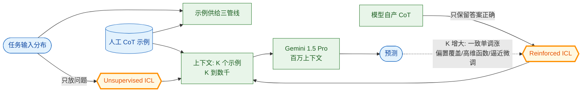

# Many-Shot In-Context Learning（千例级 ICL 的规模律）

- arXiv: https://arxiv.org/abs/2404.11018
- Source: https://arxiv.org/abs/2404.11018
- Project: （Google DeepMind，未放独立代码库）
- 本地 PDF：`papers/memory/ManyShotICL_2404.11018.pdf`
- Year: 2024 (NeurIPS 2024 Spotlight)
- Category: rl
- Priority: medium

## 一句话总结

Google DeepMind（Rishabh Agarwal、Avi Singh 等 14 人）把 ICL 从 few-shot 推到 **10³ 量级 shot**（Gemini 1.5 Pro 百万级上下文解锁）：跨 11 类任务一致大幅超越 few-shot（Sequential Parity +36.4、BBH +15.3、MATH 约 +21、GSM8K 迁移 +15 等）；两个配套方法解决示例供给瓶颈——**Reinforced ICL**（模型自产 CoT、只保留答案正确的示例）与 **Unsupervised ICL**（只放问题不放 rationales），在 many-shot 区间尤其有效；并展示 many-shot 的三个 few-shot 做不到的能力：**覆盖预训练偏置**（语义无关标签的情感分类 few-shot 崩、many-shot 成）、**学高维数值函数**（64 维分类）、**逼近微调效果**；最后给工程判据——**next-token 预测损失不是 ICL 性能的可靠代理**。与库内 more-agents（采样宽度规模律）构成 test-time scaling 的"宽度×深度"两轴：那边堆 rollout，这边堆示例。

## 九问速览

1. **Problem**：ICL 研究被 2K 上下文锁死在 few-shot；长上下文模型出现后，"千例 ICL"的行为规律（收益曲线、示例供给、与微调的关系）没人系统刻画。
2. **Bottleneck**：高质量人工示例（带 CoT rationales）供给不足；示例顺序/子集选择在千例尺度上变成新问题（论文还顺带发现顺序影响可被规模稀释）。
3. **Insight**：把 ICL 当 test-time scaling 的一条轴（示例数 K 而非参数量/rollout 数）扫到底，观察收益形态与能力质变。
4. **Method**：Gemini 1.5 Pro/Flash，K 从 1 扫到数千（Sequential Parity 到 8192）；Reinforced ICL（自产正确 CoT）与 Unsupervised ICL（纯问题）两条省人力的示例管线。
5. **Evidence**：11 任务全面涨（图 1 的柱状对比）；偏置覆盖实验——语义无关标签（如 sentiment 用 0/1 类比）下 few-shot 近随机、many-shot 恢复高准确率；128-shot 上下文学出的 GSM8K 代码验证器让 Bo-4 从 77.25% 逼近 Pass@4 的 90%。
6. **Ablation**：Reinforced vs 人工 vs Unsupervised 示例质量阶梯；示例顺序与数量在两种范式下的影响（few-shot 顺序敏感、many-shot 钝感）；NTP 损失与下游 ICL 的脱钩。
7. **Assumption**：长上下文注意力在 10³ token 级仍有效（"lost in the middle" 式衰减在 Gemini 1.5 上可接受）；任务可被示例充分描述。
8. **Failure**：推理成本随 K 线性涨（无 KV 复用时的服务成本）；接近饱和的任务（MMLU 级）增益小；自产示例的质量天花板传导到 Reinforced ICL 上限。
9. **Opportunity**：示例选择算法（千例尺度下"选哪些"远未优化）；与微调的成本-效果 crossover 建模；ICL 专用 KV cache 压缩。

| 维度 | 论文答案 |
|---|---|
| Perception | 千例示例直接占满上下文——上下文即数据集 |
| Closed-loop | 无执行闭环；Bo-N 验证器实验是"学到的组件接入闭环"的示例 |
| Correction | 错误示例被多数正确示例平滑（偏置覆盖实验的反向证据） |
| Deployment | 无训练部署；成本 = K 倍输入 token，需 KV cache 工程 |

## 核心技术

*架构速览：示例数 K 作为 test-time scaling 轴扫到 10³；Reinforced/Unsupervised 两条示例供给管线解决人力瓶颈；能力质变=偏置覆盖+高维函数+逼近微调*

1. **示例供给管线**：Reinforced ICL——模型对训练问题自产 CoT，按最终答案正确性过滤后入上下文（放弃"必须是金标准 rationale"的洁癖）；Unsupervised ICL——连答案都不要，只放问题（模型自行归纳任务格式与领域）。两者在 many-shot 区间把"示例工程"从人力问题变成算力问题。
2. **偏置覆盖实验**：情感分析用语义无关标签（"Armadillo/ Porcupine"式），few-shot 时模型被预训练语义拉偏接近随机，many-shot 后重新学到任意映射——**预训练先验可被上下文证据压过**，这是 few-shot 理论（贝叶斯先验主导）与 many-shot（似然主导）的分界实证。
3. **高维数值函数**：64 维分类等任务 few-shot 学不动、many-shot 显著——上下文容量跨过任务的有效维度阈值。
4. **上下文验证器**：GSM8K 代码解题的正确/错误解各取若干当示例，模型 in-context 学会判对错（P(Yes|正确) 与 P(Yes|错误) 分离），Bo-4 从 77.25% → 接近 90%（Pass@4 上限）——**验证器也能 ICL**，与 RL/BoN 管线的接口。
5. **NTP 损失失效判据**：示例数增加时 next-token 损失与下游任务表现的相关性断裂——评估 ICL 不能只看语言建模损失。

## 底层原理与数学推导

**规模律形态**。多数任务上性能随 K 呈近似对数线性增长后缓饱和（个别任务到 8192 仍线性）——与 more-agents 的采样宽度规模律同构但机制不同：那边是"众数估计方差下降"（统计效应），这边是"任务后验集中 + 算法迭代深化"（学习效应）。用 Akyürek 的框架读：K 增大让隐式估计器的样本量增大（θ 更准）且深度方向的"迭代步"获得更多素材——偏置覆盖对应先验强度被似然压过（Bayes 权重从先验主导向后验主导迁移）。

**Reinforced ICL 的统计效应**：自产示例若与模型当前分布同源，上下文学习近似"自我蒸馏"——期望上不会引入模型能力之外的新信息，但**格式与一致性**收益显著（论文实验：Reinforced 常打平人工示例）；这暗示 many-shot 区间内"示例一致性 > 示例智力"。

**成本模型**：输入 token 数 ∝ K·L（L 为单例长度），注意力计算 O((K·L)²)（无缓存复用时）——论文强调推理成本线性级（自回归输出不变），但预填充成本二次级；KV cache 复用与示例库前缀化是工程必修。

## 物理直觉解释

拜师学艺的两种方式：few-shot 是看两三张示范照片就上场（只能调用已有肌肉记忆的迁移）；many-shot 是在师父身边当一千天学徒（新行为模式直接长进"当场的工作记忆"里）。语义无关标签实验的直觉：照片太少时你总按老习惯干活（预训练偏置），看得够多才肯承认"这个作坊规矩就是和外面反着来"。Reinforced ICL 则是"师兄示范"——水平未必比师父好，但动作路数和你同源、演示密度够高，学格式反而更快。

## 工程细节与实操指南

- 主力模型 Gemini 1.5 Pro（1M 上下文）；对照 GPT-3.5/GPT-4o（受限上下文做 few-shot 上界）与 Gemini 1.0。
- 实操配方：推理类任务（MATH/GSM8K/GPQA/BBH）示例带 CoT；先用 Reinforced 管线把 K 拉满（512-2048 常见饱和点），再对"顺序/选择"做小网格——many-shot 下顺序扰动影响 <1%（省掉 few-shot 时代的顺序玄学）。
- 示例库工程：按任务族缓存前缀 KV；示例可复用排序（课程化从易到难在部分任务有增益）。
- 与微调的决策线：一次性适配任务（长尾）→ many-shot；需要延迟/成本最优的常驻能力 → 微调；论文给了"many-shot 可 rival 微调"的证据但 crossover 点任务相关。
- 验证器用法（第 2.4 节配方）：正/错解各采样若干 → 千例上下文 → P(Yes) 排序做 Bo-N——比训 reward model 便宜一个数量级。

## 实验协议清单

- 任务 11 类：GSM8K 迁移、MATH、GPQA、BBH（8 任务）、Sequential Parity（20 位）、Planning（Logistics）、Translation（英→Bemba 低资源）、XLSum 摘要、情感（语义无关标签）、64 维数值分类、GSM8K 代码验证器（Bo-N）。
- K 扫描：1 → 数千（Parity 至 8192）；报性能-K 曲线与 few-shot 上界对比。
- 示例来源三档：人工 / Reinforced / Unsupervised。
- 顺序与选择敏感性：few-shot vs many-shot 对照。
- 偏置覆盖：语义无关标签情感分类；高维函数：64 维分类。
- NTP 损失 vs 下游相关性分析。

## 消融实验与分析

- **示例来源**：Reinforced 在多数任务打平人工（复杂推理上 Unsupervised 也有效）——瓶颈从示例质量转移到示例数量。
- **顺序钝感**：few-shot 的示例顺序方差在 many-shot 下消失——规模化买来稳健性（与 task vectors 视角自洽：θ(S) 的估计方差随 K 下降）。
- **验证器曲线**：P(Yes|正确) 与 P(Yes|错误) 的分离度随 K 单调扩大；Bo-4 收益 77.25→~90。
- **NTP 脱钩**：示例数↑时语言建模损失平/升而任务表现升——解释为上下文被"挪用"做任务推断而非局部拟合。

## 技术权衡（Trade-off）

- **零训练 vs 推理成本**：K 倍输入 token + 二次预填充；延迟敏感场景要前缀缓存与示例裁剪。
- **示例供给的三档取舍**：人工（贵而准）→ Reinforced（免费但天花板=模型自己）→ Unsupervised（最便宜但需大 K）。
- **偏置覆盖是双刃剑**：能学任意映射也意味着容易被恶意/低质示例带偏——many-shot 的安全性问题被放大。
- **饱和任务无收益**：接近模型能力上限的任务（部分 MMLU 类）增益趋零——先判断任务在不在"可 ICL 区间"再投算力。

## 技术价值与演进定位

把 ICL 正式纳入 test-time scaling 家族：参数量（预训练）、推理长度（o1 式思维链）、采样宽度（more-agents）之外的第四轴——**示例深度**。演化线：GPT-3 few-shot → CoT-SC → **many-shot（'24，示例深度轴）** → 长上下文模型的原生任务适配层。对机器人主线：上下文经验回放的"深度"维度（多少条轨迹进上下文）可平移此规模律思路；VLA 的任务适配在 prompt 侧（指令+演示）与权重侧（微调）之间的成本-效果曲线可借用其 crossover 分析框架。

## 与其他论文的关系

- **more-agents**（库内，同期拉取）：同属 test-time scaling——堆采样宽度 vs 堆示例深度；两轴正交可乘（N 个采样各自带 many-shot 上下文）。
- **icl-what-algorithm**（库内，同期拉取）：机制底座——K 大时隐式估计器样本量增大、贝叶斯权重从先验向似然迁移，正是偏置覆盖的形式化解释。
- **icl-task-vectors**（库内，同期拉取）：θ(S) 估计方差随 K 下降解释顺序钝感；many-shot 的"压缩极限"问题（θ 容量是否够装千例信息）是两篇的接口。
- **algorithm-distillation**（库内，同期拉取）：经验历史的"多少步算够"与 many-shot 的 K 选择是同构问题。
- **tongyi-deepresearch Heavy Mode**（库内）：并行 n agent 各产压缩报告——若把"压缩报告"看作示例，Heavy Mode 是 many-shot 的任务特化版。

## 精读问题

1. K 饱和点由什么决定——任务的有效维度（需要拟合的参数量）还是上下文注意力容量（lost-in-the-middle）？如何设计实验分离？
2. Reinforced ICL 的"自我蒸馏"上限：模型学得到自己产不出的行为吗（示例只含它能解的题时，能学会解它解不了的题吗）？
3. 偏置覆盖的安全面：多少条对抗示例能劫持一个 many-shot 模型？与 RLHF 对齐层的交互如何？
4. KV 前缀缓存下示例库的增量更新（加一条示例只付边际成本）能否把成本曲线从 O(K) 摊成 O(1)+O(Δ)？
5. 机器人版：上下文里放 1000 条轨迹（压缩后）做任务适配 vs 微调 1000 步——crossover 在哪，轨迹的"示例长度" L 怎么压缩（与 statelinformation 的摘要问题合流）？
