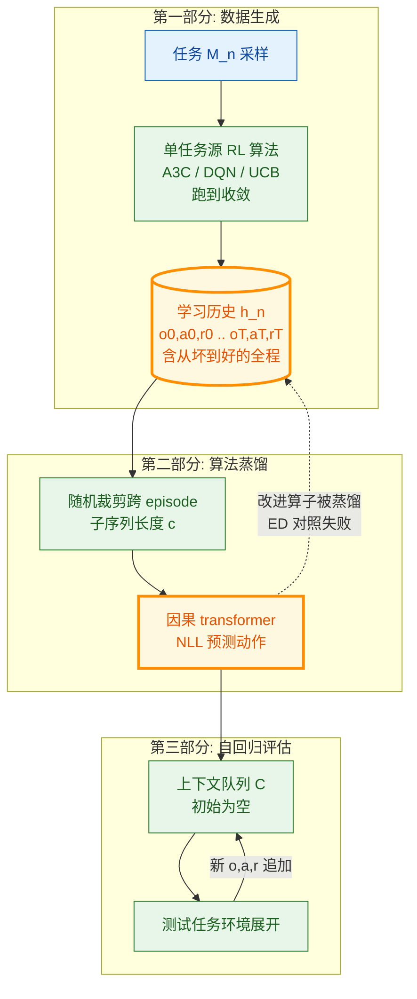

# Algorithm Distillation: In-Context Reinforcement Learning（ICL×RL 开山作）

- arXiv: https://arxiv.org/abs/2210.14215
- Source: https://arxiv.org/abs/2210.14215
- Project: https://github.com/dannybritz/AD (社区复现；官方未放码)
- 本地 PDF：`papers/rl/core/AlgorithmDistillation_2210.14215.pdf`
- Year: 2022 (ICLR 2023, 304+ 引用)
- Category: rl
- Priority: high

## 一句话总结

DeepMind（Laskin、Luyu Wang、Taiga 等）把"学会强化学习"本身变成监督序列建模问题：跑 N 个单任务 RL 源算法收集**跨 episode 学习历史** h=(o,a,r) 序列，用因果 transformer 仅以 NLL 拟合"给定历史预测动作"——因为源策略在学习历史中逐步变好，准确预测动作迫使模型同时推断"当前策略"与"改进后的策略"，即**把策略改进算子蒸馏进上下文**。纯监督训练（无 RL 损失、无权重更新）得到的模型在未见任务上展示出 in-context RL：探索、时间信用分配、数据效率甚至超过被蒸馏的 A3C/DQN 源算法；同数据量下"专家蒸馏"（ED，只学最终策略）完全失败——**数据里的学习进程是 ICL-RL 的必要成分**。基线 RL2（10 亿参数、直接用 RL 训 in-context 学习）可用纯监督方式追平。对机器人主线的意义：这是"经验即上下文"范式的原点，直接启发了库内 statelinformation（状态化训练）、wam-ttt（TTT vs ICL 之争）与 VLA 长上下文经验回放方向。

## 九问速览

1. **Problem**：Policy Distillation（MGDT/Gato）从离线数据学出多任务策略，但不能通过与环境继续交互在上下文中改进——学到了"策略"没学到"RL 算法"。
2. **Bottleneck**：训练数据里没有学习进程——离线数据是 converged 专家演示，序列模型看不到"从坏到好"的因果结构，无从蒸馏改进算子。
3. **Insight**：算法 = 长历史条件策略 P: H∪O→Δ(A)。任何 RL 算法的生命周期轨迹本身携带"策略改进"信息，行为克隆这些轨迹即蒸馏算法。
4. **Method**：源算法（A3C/DQN/UCB）逐任务跑到收敛存历史 → 因果 transformer 在长度 c 的跨 episode 子序列上做动作 NLL（二次复杂度用子序列裁剪解决）→ 评估时自回归展开、上下文队列存自己的新经验继续学。
5. **Evidence**：Dark Room / Dark Room (Hard) / Dark Key-to-Door / Watermaze 四个稀疏奖励+探索必需环境，AD 全部实现在上下文中学习且数据效率高于源 A3C/DQN；对抗老虎机任务上 AD 追平 UCB 的归一化得分、ED 失败。
6. **Ablation**：ED（同数据只学收敛后策略）不能 in-context RL——学习进程的必要性直接对照；LSTM 也能蒸馏但不如因果 transformer（Appendix K）；不条件化 return（区别于 DT/MGDT 的条件化设计）。
7. **Assumption**：源算法的历史覆盖足够多任务以学到"任务推断 + 改进"的一般结构；上下文窗口装得下有效学习历史；o/a/r 离散 token 化够用。
8. **Failure**：任务分布外泛化有限（对训练分布内任务族最有效）；上下文遗忘（长历史截断）；没在像素级大任务集外推到 LLM 级预训练（后续 Emergence of ICL-RL from Pretraining 补上）。
9. **Opportunity**：与真预训练结合、多源算法混合蒸馏、用 AD 数据增广 VLA 的经验回放、上下文管理（长历史压缩——正是 tongyi CM 模式的问题域）。

| 维度 | 论文答案 |
|---|---|
| Perception | 完整交互历史（跨 episode 的 o/a/r token 流） |
| Closed-loop | 上下文队列在部署时持续追加自身经验——真·在线 in-context 改进 |
| Correction | 学习历史天然包含源算法的错误与修正，模仿它们即学会纠错 |
| Deployment | 推理时零权重更新；上下文即"工作记忆"，冷启动空队列 |

## 核心技术

*架构速览：把 RL 算法视为长历史条件策略，用行为克隆蒸馏其学习历史；部署时上下文队列自回归追加自身经验，实现无权重更新的 in-context 强化学习*

1. **算法=历史条件策略的形式化**：P: H∪O→Δ(A)——与策略的区别仅在历史跨度（跨 episode 终身）。任何可微 RL 算法都能这样被摊销（amortize）进序列模型；AD 是这个观察的最小实现。
2. **为什么 NLL 能蒸馏出"改进"**：历史中 t 时刻的源策略 π_t 弱于 t+1 的 π_{t+1}；要准确预测 t+1 之后的动作，模型必须从上文推断出"比上文展示的更好"的策略——改进信息藏在序列的二阶统计里，一阶的模仿目标自动捕获它。
3. **工程三件套**：源算法多样性（任务级随机初始化防过拟合单任务）；子序列裁剪 c（transformer 二次复杂度的务实解）；不条件化 return（与 Decision Transformer 的 return-to-go 设计反着来——任务身份必须从历史推断而非显式给）。
4. **评估协议**：5 训练种子 × 20 评估种子；性能画成"测试时环境步数"的函数——曲线上升即 in-context RL 的直接证据（ED 的曲线平）。
5. **对照设计**：ED（同数据、去掉学习进程只留收敛段）——证明数据组成而非数据量是关键；RL2（用 RL 直接训 in-context 学习，1B 参数）——证明监督蒸馏是替代路径而非必需 RL。

## 底层原理与数学推导

**蒸馏目标**。数据集 D = {h^(n)}，每个 h 是源算法 P^source 在任务 M_n 上的生命周期轨迹。训练：

$$\mathcal{L}(\theta) = -\sum_{n=1}^{N}\sum_{t=1}^{T-1} \log P_\theta(A=a^{(n)}_t \mid h^{(n)}_{t-1}, o^{(n)}_t)$$

固定 θ 的序列模型摊销 P^source：若源算法的策略改进可写成 π_{k+1} = I(π_k, D_k)（I 为改进算子，D_k 为至今数据），则在历史条件分布下做极大似然等价于同时回归所有中间 π_k 并要求模型在"看过 k 步历史"时输出 π_{k+1} 的行为——**I 被隐式回归**。

**与 meta-RL 的贝叶斯视角对接**：in-context 推断任务后验 P(M|h) 再输出 π*(M) 是零样本泛化（ED 可达）；AD 要求的更强——推断 (M, π_k) 并外推 π_{k+1}，即同时建模任务与"算法状态"。这也是 RL2 的目标，但 RL2 用 RL 优化它（奖励驱动），AD 用源算法的监督信号（密度驱动）。

**为什么 ED 必败**：收敛后策略的历史（近.i.i.d. 高回报轨迹）里，"历史→动作"映射退化成任务识别问题，没有可外推的时间结构；模型学到 argmax E[a|h] ≈ π*，上下文变长只是降低任务后验方差，策略本身不改进。

## 物理直觉解释

学徒看师傅**完整学艺过程**的录像（包括早期的失败与纠正），与只看师傅出师后的完美表演，学到的东西完全不同：前者能内化"怎么从错误中调整"的过程本身，后者只会模仿表面动作。AD 的洞见是：改进过程就编码在历史的时序统计里，一个足够强的序列模型做纯模仿时被迫把它提取出来——就像看多了学棋录像，自己上手时也会"越下越好"，尽管脑子（权重）一个字都没改。

## 工程细节与实操指南

- 源算法选择：任何收敛的单任务 RL 都行（论文 A3C/DQN/UCB）；源算法的数据效率会限制蒸馏上限（模型学到的改进节奏来自源）。
- 上下文长度是第一瓶颈：Dark 任务几万步可塞进当时 1B 级模型窗口；真机器人历史必须做压缩/摘要（分层摘要、事件截断——即 statelinformation 的 Markovian 重建与 tongyi CM 模式）。
- 评估时保持自回归一致性：上下文队列追加的是**模型自己**的轨迹（不是源算法的），否则测的是模仿不是 in-context RL。
- 官方代码未放；社区复现 github.com/dannybritz/AD（JAX）；环境：google-research 的 dark_room + DM-Lab Watermaze。
- 迁移到 VLA 的最小实验设计：用 LIBERO/RoboTwin 的多任务 RL 微调轨迹做源历史，蒸馏 pi0 级小模型，测上下文内成功率曲线。

## 实验协议清单

- 环境：Adversarial Bandit（UCB 源）、Dark Room / Dark Room Hard / Dark Key-to-Door（A3C 源，稀疏二值奖励）、Watermaze（DQN 源，DM-Lab 像素观测）。
- 主对照四条线：AD、ED（专家蒸馏消融）、RL2-1B（meta-RL 基线）、源算法本身（数据效率参照）。
- 指标：return vs 测试时环境步数（100 种子：5 训练 × 20 评估）；Dark 1000 episode / Watermaze 160 episode。
- 泛化：训练任务族采样、测试任务族未见；老虎机任务报 UCB 归一化得分。
- 架构消融：GPT vs LSTM（Appendix K）。

## 消融实验与分析

- **ED vs AD（最关键消融）**：同数据同模型，ED 在所有环境上无法 in-context 提升（曲线平），AD 上升——学习进程是必要成分，直接证伪"数据量解释"。
- **AD vs 源算法**：Dark 环境数据效率超 A3C 源（上下文推断带来的多任务先验在起作用）；Watermaze 超 DQN。
- **AD vs RL2**：训练分布内表现相当；AD 纯监督训练成本远低——"摊销 meta-RL"路线成立的证据。
- **OOD**：对未见任务（同族）能零样本 in-context RL；跨分布外推有限（论文诚实报告）。

## 技术权衡（Trade-off）

- **监督蒸馏 vs 直接 meta-RL**：AD 稳定便宜，但上限被源算法的历史锁死（源不探索的改进模式模型学不到）；RL2 类可以超越源但没有免费午餐（训练不稳）。
- **上下文容量 vs 终身历史**：历史必须裁剪，遗忘率决定 in-context 学习的天花板——这是后续所有 in-context agent 工作的核心约束。
- **不条件化 return**：换来"任务+算法状态都要从历史推断"的更强学习信号，牺牲了推理时的可控性（不能像 DT 那样指令式调节目标回报）。
- **离散 token 化**：o/a/r 全离散，连续控制要 VQ 或归一化桶——当代 VLA 的 token 化管线（FAST 等）使这条约束已不再构成障碍。

## 技术价值与演进定位

"经验即上下文"（experience-as-context）范式的原点论文，与 Gato/MGDT 的"策略蒸馏"划清界限后开辟 in-context RL 线。演化线：Decision Transformer（条件化策略）→ Gato/MGDT（多任务蒸馏）→ **AD（算法蒸馏，ICL×RL）** → Emergence of ICL-RL from Pretraining（预训练规模涌现）→ statelinformation（状态化上下文管理）→ 机器人侧的 in-context 经验回放。与 ICL 理论线（Akyürek：ICL≈GD/Bayes）合流点：AD 的"改进算子蒸馏"可以理解为让上下文执行"策略梯度"而非"监督拟合"——两线的统一理论仍是开放问题。

## 与其他论文的关系

- **icl-what-algorithm**（库内，同期拉取）：理论侧回答"上下文里跑的是什么算法"（GD/ridge/Bayes）；AD 证明上下文里还能跑"RL 改进算子"——两篇合起来是 ICL 表达能力的上下界。
- **statelinformation**（库内）：AD 的直接后续精神——状态化训练协议让 ICL 与部署记忆分布对齐；其 Markovian 摘要正是 AD 的上下文压缩答案。
- **wam-ttt / robottt**（库内）：TTT 路线主张"经验必须进权重"；AD 是反方标杆（经验进上下文就够）——三篇构成"上下文 vs 权重"学习之争的完整三角。
- **more-agents**（库内）：采样-投票是"无学习的宽度"；AD 是"上下文中的学习"——都是权重冻结下的性能来源，机制相反。
- **Decision Transformer / MGDT / Gato**：被 AD 批评的直接前驱（策略蒸馏不学算法）。
- **RL2**：最强基线与路线对手（直接 meta-RL）。

## 精读问题

1. 源算法的探索风格会被蒸馏吗——UCB 的乐观初始化 vs ε-greedy 的历史，蒸馏出的 in-context 探索模式像谁？（论文附录有老虎机多样性分析，值得精读）
2. 子序列裁剪长度 c 与"最小有效历史"的关系：模型需要看多长的坏→好转折才能推断改进？这能否指导机器人上下文的关键帧选择？
3. 把源算法换成 LLM agent 的 RL（GRPO 轨迹），AD 能蒸馏出"agent 算法"吗——学到的会不会只是格式而非探索？
4. 上下文遗忘的定量刻画：滑动窗口截断下 in-context RL 何时退化成 ED？（这决定机器人部署的上下文管理策略）
5. 与 task vectors 的关系：AD 模型的"任务向量"与"算法状态向量"是否分离存储（可干预性实验照搬 Hendel 的方法）？
